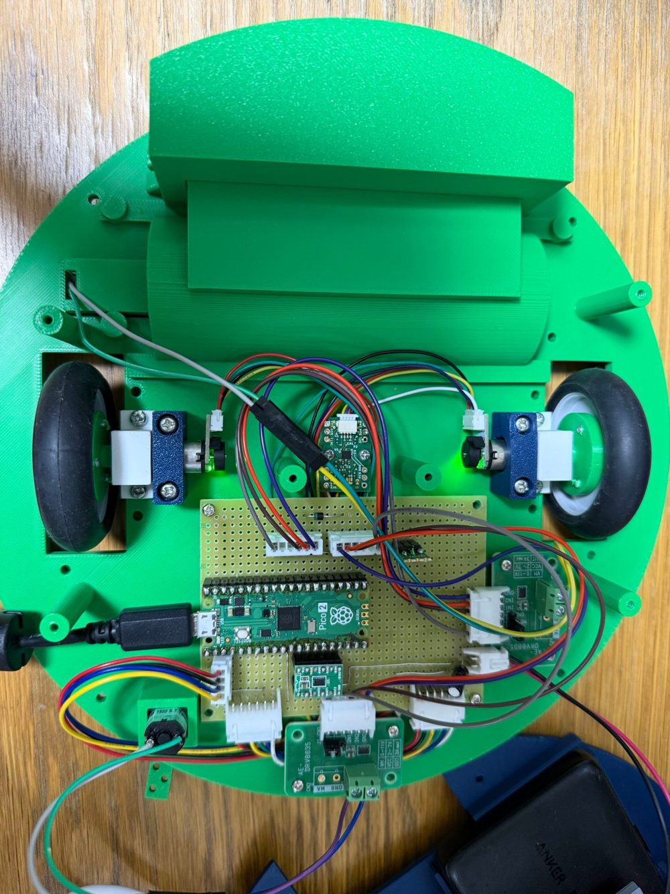
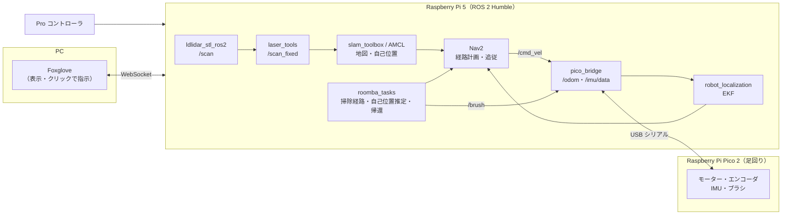

# my-roomba-nav：自作の自律移動お掃除ロボット（ROS 2）

Raspberry Pi 5・Raspberry Pi Pico 2・2D LiDAR（LD19）で作った、家庭用お掃除ロボットのソフトウェア一式です。
地図を作り、置かれた場所から自分の位置を見つけ、指定した範囲をくまなく掃除して、終わったら定位置に戻ります。

機体（外装は Fusion で設計）、回路、足回りのマイコン、ROS 2 のノードまで一人で開発しています。

<p align="center">
  
</p>
<p align="center"><sub>上ぶたを外した状態。中央が Pico 2 を載せた自作のユニバーサル基板、左右が駆動輪とエンコーダ、上がメインブラシ、左下がサイドブラシ。</sub></p>

<!-- ここに走行中の地図・経路の GIF を入れる -->

## できること

- **地図づくり**：コントローラで部屋を一周すると、slam_toolbox で地図ができる
- **自己位置推定**：起動するとその場でゆっくり回り、地図全体から自分の位置を探す
- **くまなく掃除**：地図上で範囲をクリックすると、ジグザグの掃除経路を自分で作って走る。物があって進めないときは回り道を作って続ける
- **ワンタッチ掃除**：`/clean` を呼ぶと、自己位置推定 → 登録した範囲の掃除 → 定位置へ帰還、までを自動で行う
- **ウェイポイント走行**：クリックした点を順番に回る（回り続ける見回りも可）
- **手動操作**：Pro コントローラで走行とブラシ（メイン・サイド）を操作
- **可視化**：PC の Foxglove から、地図・スキャン・経路・掃除し終えた所を見ながら操作

## システム構成



## パッケージ構成

| パッケージ | 言語 | 中身 |
|---|---|---|
| [`pico_bridge`](src/pico_bridge) | C++ | Pico との USB シリアル通信。速度指令をタイヤに送り、エンコーダと IMU からオドメトリを出す。EKF の設定 |
| [`laser_tools`](src/laser_tools) | C++ | LD19 のスキャンを、SLAM が扱える形（いつも同じ点の数）に並べ直し、ノイズを消す |
| [`roomba_tasks`](src/roomba_tasks) | C++ | くまなく掃除の経路生成と実行、ウェイポイント走行、自己位置推定、定位置への帰還、ブラシ操作 |
| [`roomba_nav`](src/roomba_nav) | Python | ロボット一式・SLAM・地図走行の launch。Nav2 の標準設定をこのロボット用に書き換えて使う |
| [`ldlidar_stl_ros2`](https://github.com/ldrobotSensorTeam/ldlidar_stl_ros2) | C++ | LiDAR のドライバ（**外部**、サブモジュール） |

`ldlidar_stl_ros2` 以外はすべて自作です（約 3,000 行、テストを含む）。

## 工夫したところ

### くまなく掃除する経路を自分で作る（`roomba_tasks/coverage.hpp`）

Nav2 には「範囲をくまなく走る」機能がないので、地図（占有格子）から往復のジグザグ経路（ボストロフェドン）を作る部分を自作しました。

1. 距離変換（Felzenszwalb & Huttenlocher）で各マスから壁までの距離を求め、ロボットの中心が通ってよいマスを決める
2. ロボットからつながっているマスだけを残す（壁の向こうの部屋などを除く）
3. 平行なレーンを引き、障害物で分かれた「区画」ごとにジグザグで走る
4. 次に走る区画は、ダイクストラ法で**壁を回り込んだ実際の道のり**が一番近いものを選ぶ
5. レーンの向きは、区画とレーンの数が一番少なくなる向きを自動で選ぶ

レーンの間隔は 10 cm で、メインブラシの幅（11.4 cm）より少し狭くして塗り残しを防いでいます。

**途中で進めなくなったとき**：作った経路は Nav2 の controller_server（Regulated Pure Pursuit）にそのまま渡して走らせます。物が置いてあるなどで進めなくなったら、経路の少し先（0.4 m × 失敗回数）の点まで Nav2 の planner で回り道を作り、続きから再開します。ちゃんと進めたら失敗回数を戻し、5 回続けて失敗したらあきらめます。

### 置いた場所が分からなくても動き出せる（`roomba_tasks/localize.cpp`）

AMCL の位置の候補を地図全体にばらまき、その場でゆっくり回りながら AMCL に計算させ続けます。位置のばらつきが 25 cm、向きのばらつきが約 20° 以下になったら止まります。どこに置いても、自分の位置を見つけてから掃除を始められます。

### LiDAR のスキャンを SLAM に通す（`laser_tools`）

LD19 は 1 周ごとに点の数が変わるため、そのままでは slam_toolbox が受け付けません。角度を 500 個のマスに並べ直すノードを挟み、あわせて、ロボット自身の体（支柱・配線）が映った近すぎる点と、ぽつんと 1 点だけのノイズを消しています。

### オドメトリと IMU を合わせる（`pico_bridge`）

タイヤのエンコーダから計算した位置と IMU の角速度を、robot_localization の EKF で合わせています。接続した直後の 2 秒で、ジャイロのずれを測って補正します。

### 止まるべきときに確実に止まる

- 速度指令（`/cmd_vel`）が 0.5 秒来なければ、ブリッジが停止を送る
- ブリッジやケーブルが止まっても、Pico 自身が 0.5 秒で止まる
- ブラシの指令が 1 秒途切れたらブラシを止める
- 速度には上限（0.3 m/s、2.0 rad/s）をかける

### ROS に依存しない部分を切り出してテストする

経路生成（`coverage.hpp`）、スキャンの並べ直し（`resample.hpp`）、差動二輪の計算（`diffdrive.hpp`）はヘッダーに切り出し、ROS なしで単体テストできるようにしています。

## ハードウェア

- Raspberry Pi 5（ROS 2 Humble、コンテナ上で実行）
- Raspberry Pi Pico 2（モーター・ブラシ・エンコーダ・IMU の制御）
- LiDAR：LDROBOT LD19
- 駆動：差動二輪、メインブラシ・サイドブラシ
- 操作：Pro コントローラ
- 外装：直径 30 cm、Fusion で設計

## 動かし方

```bash
mkdir -p ~/roomba_ws && cd ~/roomba_ws
git clone --recursive git@github.com:8010yama/my-roomba-nav.git .
colcon build
source install/setup.bash

ros2 launch roomba_nav robot.launch.py      # ロボットだけ（手動操作・LiDAR・Foxglove）
ros2 launch roomba_nav nav_slam.launch.py   # 地図を作りながら走る
ros2 launch roomba_nav nav_map.launch.py    # 保存した地図の上で走る（起動時に自己位置推定）
```

詳しい手順（必要なパッケージ、地図の保存、掃除範囲の登録、サービス一覧）は各パッケージの README を見てください。

- [roomba_nav](src/roomba_nav/README.md)：起動・SLAM・地図走行・掃除の操作
- [roomba_tasks](src/roomba_tasks/README.md)：掃除経路の作り方
- [pico_bridge](src/pico_bridge/README.md)：足回りとの通信・寸法の設定・安全の仕組み

## テスト

```bash
colcon test --packages-select laser_tools pico_bridge roomba_tasks
colcon test-result --verbose
```
